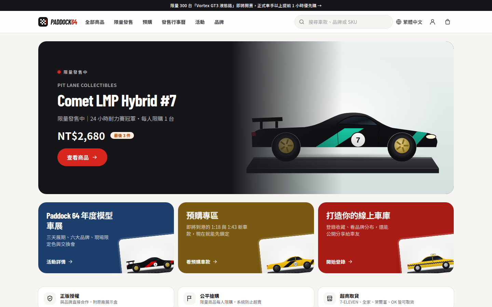
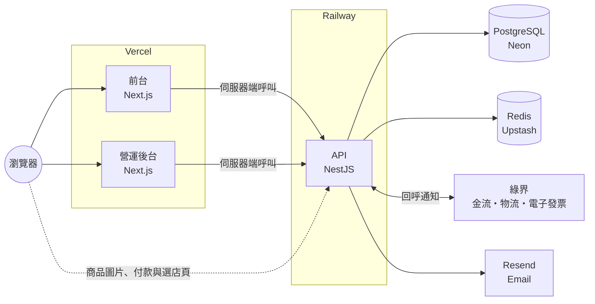
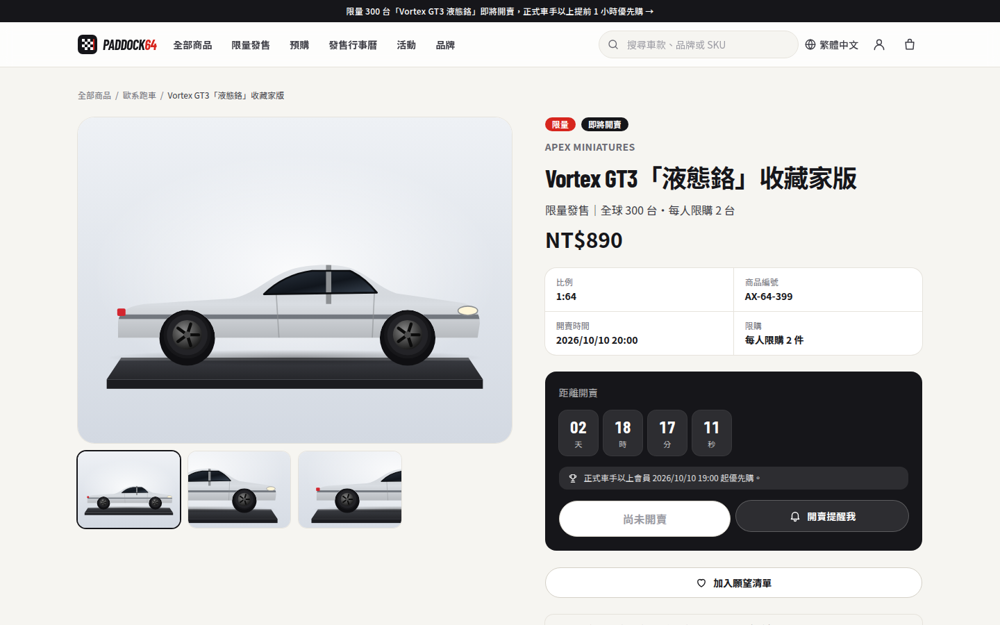
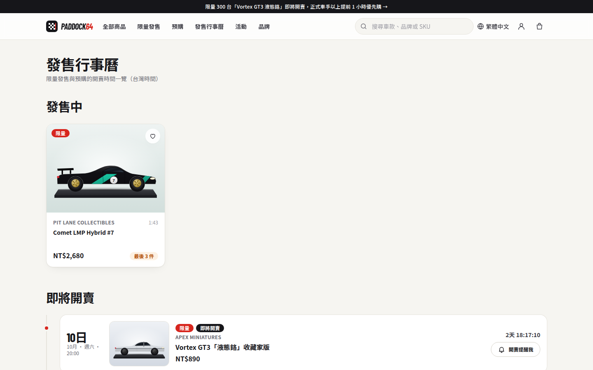
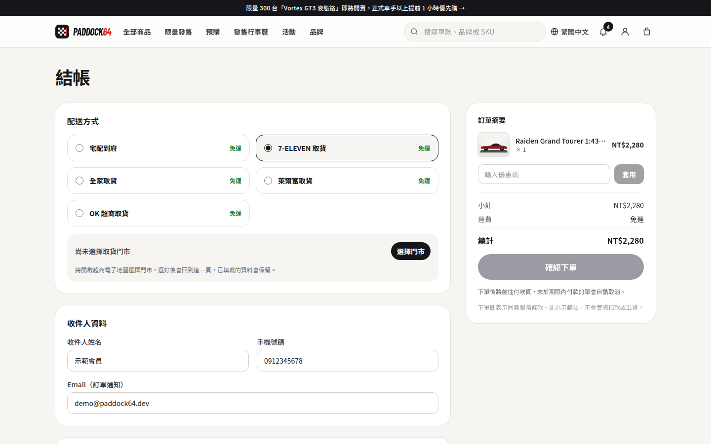
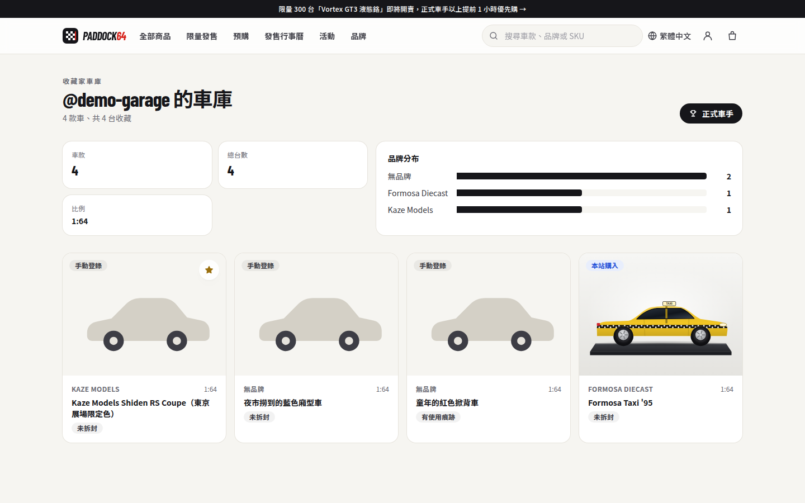
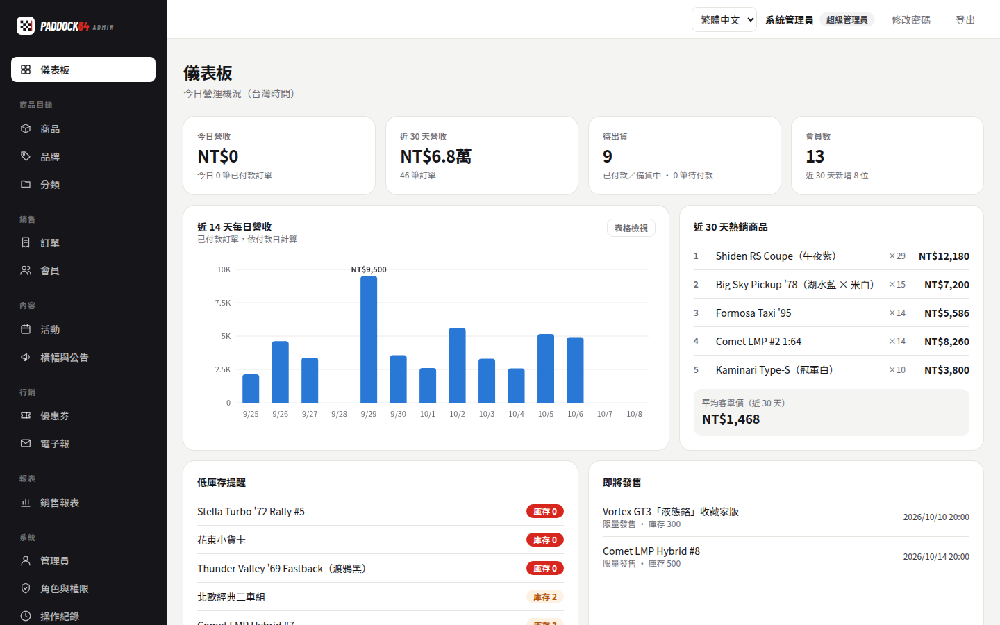
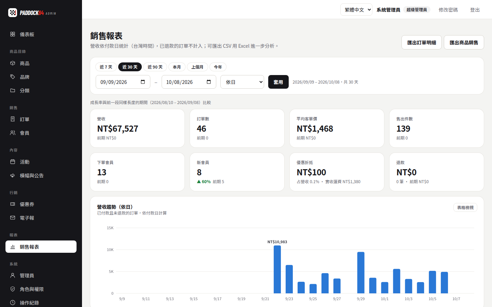
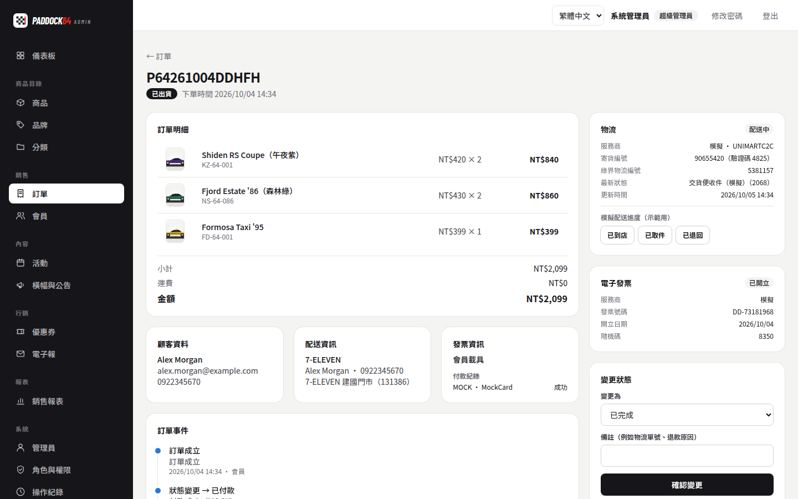
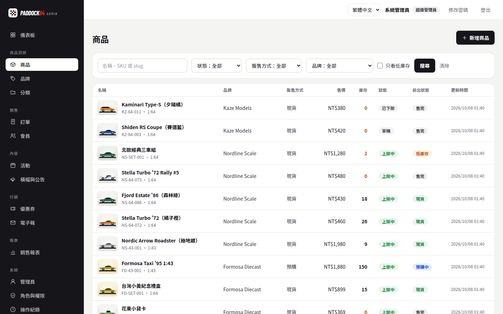

# Paddock 64｜模型車收藏電商平台

[](https://github.com/papap35/diecast-platform/actions/workflows/ci.yml)

1:64 模型車的限量發售、預購與收藏平台，包含前台購物網站、營運後台與 REST API。這是一個從需求分析、架構設計、實作、測試一路做到雲端部署的作品集專案。

> 品牌「Paddock 64」與所有車款、品牌皆為虛構。金流、物流與電子發票預設使用內建的模擬服務，不會真的扣款、寄送或開立發票；也可以切換到綠界的測試環境。



## 線上示範

| 服務     | 網址                | 示範帳號                                  |
| -------- | ------------------- | ----------------------------------------- |
| 前台     | _部署後填入_        | `demo@paddock64.dev` / `Paddock64!demo`   |
| 營運後台 | _部署後填入_        | `admin@paddock64.dev` / `Paddock64!admin` |
| API 文件 | _部署後填入_`/docs` | —                                         |

後台另有兩個權限較少的角色可以比較：營運人員 `ops@paddock64.dev` / `Paddock64!ops`、客服人員 `cs@paddock64.dev` / `Paddock64!cs`。示範站每天凌晨重整資料，示範帳號不能修改密碼或刪除（[說明](docs/deployment.md#公開示範環境)）。

## 功能

**前台**（三語系：繁體中文、English、简体中文）

- 商品瀏覽：分類、品牌、比例與價格篩選、搜尋；各語系網址（hreflang）、sitemap 與商品結構化資料。
- 限量發售：開賣倒數、會員等級優先購、每人限購、開賣提醒、發售行事曆。
- 預購：截止時間、預計出貨日，預購與現貨分開結帳。
- 結帳：超商取貨（7-ELEVEN、全家、萊爾富、OK，電子地圖選店）與宅配；電子發票（會員載具、手機條碼、自然人憑證、捐贈、統一編號）；優惠碼。
- 會員中心：訂單與物流進度、站內通知、願望清單（補貨通知）、會員等級與權益、我的車庫（本站購入自動入庫，可公開分享）。

**營運後台**

- 儀表板：今日與近 30 天營收、待出貨、熱銷、低庫存、即將發售。
- 商品、品牌、分類：多語系內容、庫存調整與異動紀錄。
- 訂單：狀態流程、建立物流單、電子發票開立／作廢／折讓、內部備註與完整事件軸。
- 會員：等級與累計消費、收藏車庫、停權。
- 內容與行銷：活動、首頁橫幅與全站公告、優惠券（折抵、折扣、免運）、電子報（分眾、排程、測試信、一鍵退訂）。
- 報表：營收趨勢與前期比較；品牌、分類、銷售型態、配送方式、會員等級分析；訂單與商品銷售 CSV 匯出。
- 系統：管理員與角色權限、操作紀錄、寄信紀錄（失敗重寄）、系統設定（運費、免運門檻、付款期限）。

**API**：REST + OpenAPI 文件，前台、後台與未來的 iOS／Android App 共用；`packages/api-client` 由 OpenAPI 規格產生型別安全的 client。

## 技術重點

- **限量發售不超賣**：開賣瞬間先經過 Redis Lua 閘門預扣名額，售完的請求不進資料庫；通過的請求在交易內以條件式 UPDATE 扣庫存，多商品依固定順序上鎖避免死結。以 k6 模擬 1,000 人搶 300 台，14 次測試都剛好成立 300 筆訂單（[壓力測試報告](docs/load-testing.md)）。
- **交易一致性**：Email、電子發票與訂單在同一個資料庫交易寫入（outbox），由排程送出；失敗會間隔拉長重試，超過上限才交給人工處理，第三方故障不會讓訂單失敗。
- **第三方整合可替換**：金流、物流、電子發票都以介面抽象，內建模擬與綠界兩種實作；回呼驗證 CheckMacValue，重複通知不會重複入帳。
- **台灣電商細節**：統一編號檢查碼、手機條碼與自然人憑證格式、超商電子地圖、退貨跨期改開折讓單、優惠券以最大餘數法分攤到各品項（發票單價維持整數）。
- **權限與稽核**：角色權限每次請求重新讀取；refresh token 輪替並偵測重放；改密碼後舊權杖全部失效；後台寫入都記到操作紀錄（密碼等欄位遮蔽）。
- **測試**：72 個單元測試與 101 個端對端測試（連真的 PostgreSQL 與 Redis），GitHub Actions 每次提交執行，並檢查 OpenAPI 規格與 client 是否同步。

更完整的設計說明見[系統架構](docs/architecture.md)與[架構決策紀錄](docs/adr/)。

## 系統架構



前台與後台只在伺服器端呼叫 API，權杖存在 httpOnly cookie，瀏覽器拿不到。

| 層         | 技術                                                                          |
| ---------- | ----------------------------------------------------------------------------- |
| 前台、後台 | Next.js 16（App Router、Server Actions）、React 19、Tailwind CSS 4、next-intl |
| API        | NestJS 12、Prisma 7（pg driver adapter）、class-validator、Swagger            |
| 資料       | PostgreSQL 16、Redis 7                                                        |
| 測試       | Vitest、Supertest、k6                                                         |
| 品質       | TypeScript（strict）、ESLint、oxlint、Prettier、GitHub Actions、Dependabot    |
| 部署       | Vercel、Railway（Docker）、Neon、Upstash                                      |

## 專案結構

```text
apps/
  api/          NestJS REST API：模組、Prisma schema 與遷移、示範資料、壓測腳本
  web/          前台（Next.js）
  admin/        營運後台（Next.js）
packages/
  api-client/   由 OpenAPI 規格產生的型別與 fetch client
docs/           架構、部署、金流、壓力測試報告與 ADR
```

## 本機開發

需要 Node.js 22.12 以上、pnpm 10 與 Docker。

```bash
corepack enable
pnpm install
docker compose up -d                       # PostgreSQL 16 與 Redis 7
cp apps/api/.env.example apps/api/.env
pnpm db:deploy                             # 建立資料表
pnpm db:seed                               # 示範資料：商品、會員、訂單、活動…
pnpm dev                                   # 前台 :3000、後台 :3001、API :4000（文件 /docs）
```

前台與後台預設連 `http://localhost:4000`，本機不需要另外設定環境變數（可參考各自的 `.env.example`）。

```bash
pnpm lint && pnpm typecheck
pnpm test                                  # 單元測試
pnpm --filter @paddock64/api test:e2e      # 端對端測試（自動建立 paddock64_test 資料庫）
pnpm openapi                               # API 有變動時重新產生 OpenAPI 規格與 client
```

## 截圖

| 限量發售倒數                                    | 發售行事曆                                       |
| ----------------------------------------------- | ------------------------------------------------ |
|       |  |
| **結帳（超商取貨、電子發票）**                  | **公開車庫**                                     |
|       |      |
| **後台儀表板**                                  | **銷售報表**                                     |
|  |   |
| **訂單（物流、發票、事件軸）**                  | **商品管理**                                     |
|        |  |

## 文件

- [系統架構](docs/architecture.md)：模組、資料模型、關鍵流程與排程。
- [部署指南](docs/deployment.md)：Neon、Upstash、Railway、Vercel 與公開示範環境。
- [金流、物流與電子發票](docs/payments.md)：模擬服務與綠界測試環境。
- [限量發售壓力測試](docs/load-testing.md)：情境、數據與根據數據做的調整。
- [架構決策紀錄](docs/adr/)：重要的技術選擇與取捨。

## 開發方式

這是自主發起的作品集專案：以實際的電商需求（限量發售、超商取貨、電子發票）為題，在 AI 協作（Claude Code）下完成需求拆解、架構設計、實作、測試與部署設定。所有功能都有自動化測試，並以瀏覽器實際操作驗證。

## 授權

[MIT](LICENSE)
