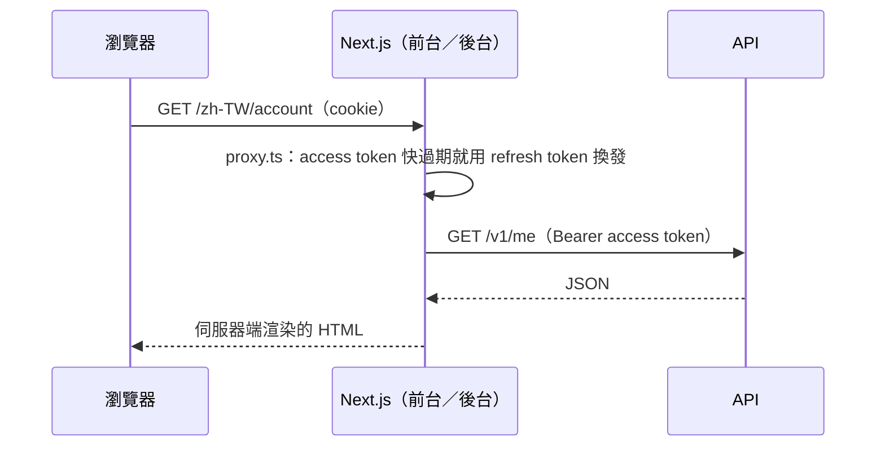
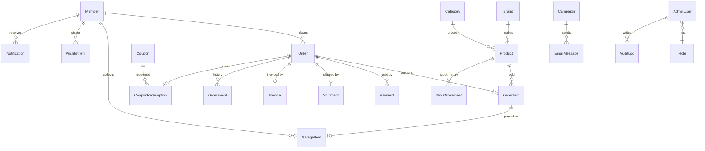
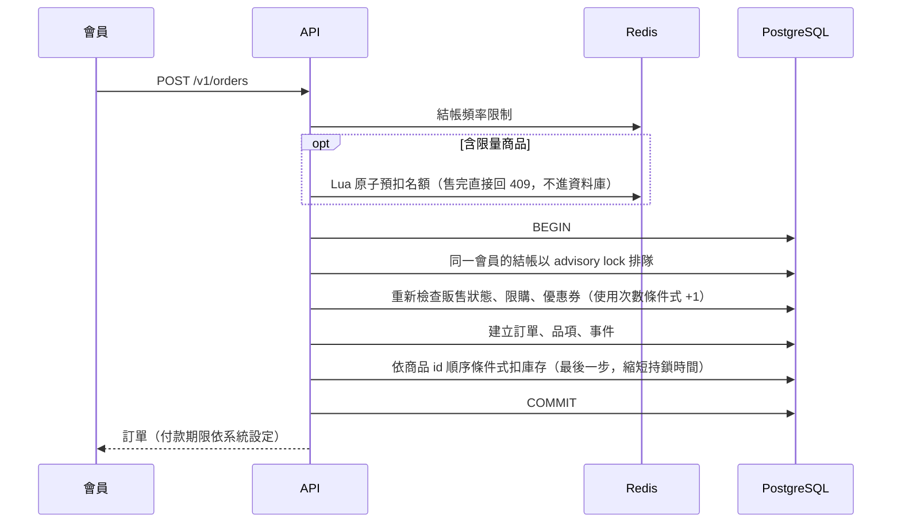

# 系統架構

這份文件說明 Paddock 64 的系統組成、API 模組、資料模型、關鍵流程、背景排程與安全設計。部署方式見[部署指南](deployment.md)，個別技術選擇的理由見[架構決策紀錄](adr/)。

## 系統組成

| 應用                  | 技術                              | 說明                                                                     |
| --------------------- | --------------------------------- | ------------------------------------------------------------------------ |
| `apps/web`            | Next.js 16（App Router）          | 前台。Server Component 讀資料、Server Action 寫資料，三語系（next-intl） |
| `apps/admin`          | Next.js 16（App Router）          | 營運後台。依角色權限顯示選單與頁面                                       |
| `apps/api`            | NestJS 12、Prisma 7               | REST API 與背景排程，前台、後台與未來的 App 共用                         |
| `packages/api-client` | openapi-typescript、openapi-fetch | 由 API 的 OpenAPI 規格產生的型別與 client，前後台共用同一份型別          |

### 請求怎麼走

1. 瀏覽器只跟 Next.js 互動。登入後的 access token 與 refresh token 存在 httpOnly cookie，瀏覽器的 JavaScript 讀不到。
2. Next.js 在伺服器端帶著 `Authorization: Bearer` 呼叫 API。頁面請求由 `proxy.ts`（middleware）在權杖快過期時先換發；Server Action 在送出前自己檢查。
3. 例外是三種直接打 API 的情境：商品圖片（`/static`）、模擬付款頁與模擬選店頁、綠界的回呼通知。

## API 模組

| 模組                    | 職責                                                 |
| ----------------------- | ---------------------------------------------------- |
| `auth`                  | 會員與後台登入、權杖簽發與輪替、角色權限 guard       |
| `members`               | 會員資料、會員等級與權益、刪除帳號（去識別化）       |
| `catalog`               | 商品、品牌、分類（前台查詢與後台管理）、販售狀態判斷 |
| `cart`                  | 購物車、結帳試算、限購與可購買數量                   |
| `orders`                | 結帳、訂單狀態機、未付款逾期取消、會員累計消費       |
| `inventory`             | 扣庫存與異動紀錄、限量發售的 Redis 閘門              |
| `payments`              | 付款（模擬／綠界全方位金流）、付款通知               |
| `logistics`             | 超商電子地圖選店、物流單、物流狀態通知（模擬／綠界） |
| `invoices`              | 電子發票開立、作廢、折讓與重試（模擬／綠界 B2C）     |
| `ecpay`                 | 綠界共用的 CheckMacValue 簽章與欄位格式              |
| `notifications`         | 站內通知、Email 外寄匣與寄信紀錄                     |
| `wishlist`、`reminders` | 願望清單與補貨通知、開賣提醒                         |
| `garage`                | 我的車庫：訂單完成自動入庫、手動登錄、公開分享       |
| `events`、`content`     | 活動（車展、聚會、發售）、首頁橫幅與全站公告         |
| `coupons`、`marketing`  | 優惠券計價與使用紀錄、電子報與退訂                   |
| `reports`               | 銷售報表與 CSV 匯出                                  |
| `settings`              | 系統設定（運費、免運門檻、付款期限）                 |
| `admin`、`system`       | 後台的訂單與會員管理、儀表板；管理員、角色與操作紀錄 |
| `health`                | 部署平台的健康檢查（資料庫與 Redis）                 |

模組之間透過 Nest 的依賴注入呼叫彼此的 service；跨模組的「副作用」（入帳後開發票、出貨後通知）在同一個資料庫交易裡寫入待辦資料，由排程處理（見[背景排程](#背景排程)）。

## 資料模型

核心資料表與關聯（省略翻譯、圖片等附屬資料表）：

幾個設計重點：

- **快照**：訂單品項保存下單當下的商品名稱、單價與分攤的折扣，商品改價或改名不影響歷史訂單與發票。
- **金額一律為整數新台幣**：避免浮點誤差；百分比折扣以 `Math.floor` 計算，再以最大餘數法分攤到各品項。
- **庫存異動紀錄**：每一次庫存變化（下單、取消、逾期、後台調整）都寫一筆 `StockMovement`，記錄變化量與變化後的餘額。
- **主鍵**：UUID v7（時間有序），索引局部性比隨機 UUID 好，又不會像流水號一樣洩漏訂單量。
- **資料庫層的約束**：庫存與金額的 CHECK、優惠券使用次數的條件式更新、單列系統設定，資料錯誤在資料庫就會被擋下。

## 關鍵流程

### 結帳與扣庫存

- 交易中任何一步失敗（庫存不足、超過限購）整筆回滾，Redis 預扣的名額歸還。
- 未付款的訂單由排程在付款期限後取消，歸還庫存與優惠券使用次數。
- 設計演進與壓測數據見[限量發售壓力測試](load-testing.md)。

### 付款、出貨與發票

1. 會員按下付款，API 建立一筆付款嘗試（每次不同的 `MerchantTradeNo`），導向綠界或模擬付款頁。
2. 付款結果以伺服器對伺服器的通知回到 API：驗證 CheckMacValue → 以條件式更新把訂單改為已付款（重複通知不會重複入帳）→ 同一個交易寫入待開發票、站內通知與 Email。
3. 後台建立物流單後，物流狀態由綠界通知更新；超商取件完成時訂單轉為已完成，商品自動停進會員的車庫。
4. 退款時作廢發票；發票開立超過申報期限時改開折讓單。

### 電子報

草稿 → 排程 → 排程每分鐘檢查到期的電子報，分批寫入 Email 外寄匣（同一封電子報對同一個收件人只會寫入一次，中斷後可安全接續）→ 外寄匣排程寄出。信件帶 RFC 8058 一鍵退訂標頭。

## 背景排程

API 內建排程（`@nestjs/schedule`）。多個執行個體同時運作時，每個排程先以 Redis `SET NX` 取得鎖，同一時間只有一個執行個體在跑。

| 排程                   | 頻率     | 工作                                                       |
| ---------------------- | -------- | ---------------------------------------------------------- |
| `expire-unpaid-orders` | 每分鐘   | 取消逾期未付款的訂單，歸還庫存與優惠券                     |
| `process-invoices`     | 每 30 秒 | 開立、作廢電子發票；失敗間隔拉長重試，超過上限交給人工處理 |
| `send-emails`          | 每 30 秒 | 寄出外寄匣的信件；失敗依 1、5、15、60 分鐘重試             |
| `send-campaigns`       | 每分鐘   | 到期的電子報分批寫入外寄匣                                 |
| `release-reminders`    | 每分鐘   | 開賣（或優先購開始）前 15 分鐘通知設定提醒的會員           |
| `wishlist-restock`     | 每分鐘   | 商品補貨時通知把它加入願望清單的會員                       |

公開示範環境另有每天一次的資料重整（GitHub Actions，見[部署指南](deployment.md#公開示範環境)）。

## 安全

- **權杖**：access token 是 15 分鐘的 JWT，會員與後台分開（audience 不同）；refresh token 是不透明亂碼，資料庫只存 SHA-256 雜湊，每次換發都輪替，舊的 token 被重複使用時整個 family 作廢。
- **密碼**：Node 內建 scrypt，參數寫在雜湊字串裡，日後可以平滑調整強度。改密碼後舊權杖全部失效。
- **後台權限**：角色持有權限字串，每次請求都重新從資料庫讀取角色，權限調整立即生效；超級管理員至少保留一位。
- **操作紀錄**：後台成功的寫入都記錄操作者、對象與送出的內容（密碼、token 等欄位遮蔽，過長內容截斷）。匯出含個資的 CSV 另外需要訂單檢視權限，也會記錄。
- **輸入驗證**：所有 DTO 以 class-validator 白名單驗證；統一編號、手機條碼、自然人憑證等台灣格式有專門的驗證。
- **流量控制**：全域每個 IP 每分鐘請求上限（每個執行個體各自計算），結帳另外以 Redis 限制頻率。
- **其他**：helmet 安全標頭、CSV 匯出防公式注入、`DEMO_MODE` 保護公開的示範帳號。

## 國際化與時區

- 前台三語系（`zh-TW`、`en`、`zh-CN`），網址帶語系前綴；後台以 cookie 切換語系。
- API 的內容類資料（商品、分類、活動、橫幅、電子報）各語系分開存放，`?locale=` 或 `Accept-Language` 決定回傳的語系，缺翻譯時退回繁體中文。
- 台灣沒有夏令時間，日期計算（報表的「天」、開賣時間）一律以固定 UTC+8 換算，資料庫存 UTC。

## 可觀測性

- `/v1/health` 同時檢查資料庫與 Redis，部署平台以此判斷執行個體是否健康。
- 訂單事件軸、操作紀錄、寄信紀錄、庫存異動紀錄讓後台可以追溯每一筆資料的來龍去脈。
